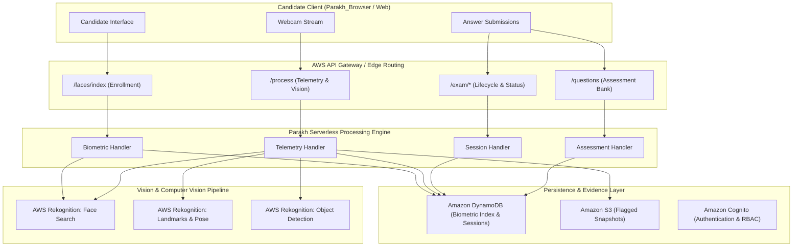

# Parakh_Browser

> **Next-Generation Academic Assessment & Intelligent Proctoring Engine**  
> *Engineered for secure, fair, and seamless examination administration.*

---

## 📌 Executive Overview

**Parakh_Browser** is a high-performance proctoring and assessment platform engineered to uphold academic integrity in high-stakes online examinations. It provides a multi-layered verification framework combining biometric authentication, real-time environment auditing, head pose/gaze tracking, and tamper-resistant session management.

### Key Capabilities

- **Facial Biometric Verification**: Secure candidate registration and live biometric matching using neural face embedding collections.
- **Environmental Anomaly Detection**:
  - Detection of unauthorized objects (smartphones, electronic devices, books, earphones).
  - Multi-person detection within the camera viewport.
  - Absence detection (candidate leaving viewport).
- **Head Pose & Gaze Orientation**: Yaw, pitch, and roll telemetry calculations to detect unnatural attention shifts.
- **Evidence Archival**: Automated S3-backed violation snapshots capturing forensic evidence upon anomaly trigger.
- **Fault-Tolerant Session Management**: Real-time heartbeat tracking, connection retry logic, and tamper protection.
- **Serverless Cloud Architecture**: Built on AWS SAM (Serverless Application Model), leveraging AWS Rekognition, DynamoDB, Cognito, and API Gateway for horizontal scalability and low latency.

---

## 🚀 Quick Access

- **Candidate Assessment Portal**: [http://127.0.0.1:8000](http://127.0.0.1:8000)
- **Examiner Audit Console**: [http://127.0.0.1:8000/examiner](http://127.0.0.1:8000/examiner)
- **System Health & Telemetry**: [http://127.0.0.1:8000/health](http://127.0.0.1:8000/health)

---

## 🏛️ Architecture Overview



---

## 📂 Project Structure

```
Parakh_Browser/
├── .github/
│   └── workflows/
│       └── ci.yml                 # Automated CI verification workflow
├── src/
│   ├── config/
│   │   ├── env.js                 # Centralized configuration & environment loader
│   │   └── aws.js                 # AWS service client initializations
│   ├── controllers/
│   │   ├── assessment.controller.js # Question retrieval and answer synchronization
│   │   ├── biometric.controller.js  # Biometric enrollment controller
│   │   ├── session.controller.js    # Session start, stop, and status evaluation
│   │   └── telemetry.controller.js  # Video frame proctoring and anomaly analysis
│   ├── handlers/
│   │   ├── assessmentHandler.js   # Serverless lambda wrapper for assessment endpoints
│   │   ├── biometricHandler.js    # Serverless lambda wrapper for candidate biometrics
│   │   ├── sessionHandler.js      # Serverless lambda wrapper for session lifecycle
│   │   └── telemetryHandler.js    # Serverless lambda wrapper for frame processing
│   ├── middlewares/
│   │   └── auth.middleware.js     # Token verification and authorization guard
│   ├── services/
│   │   ├── assessment.service.js  # Question delivery and state recording
│   │   ├── database.service.js    # DynamoDB & remote store data abstraction
│   │   ├── session.service.js     # Exam session tracking and heartbeat supervisor
│   │   ├── storage.service.js     # S3 evidence snapshot uploader
│   │   └── vision.service.js      # AI Computer Vision pipeline (Rekognition)
│   └── utils/
│       ├── logger.js              # Structured JSON logging utility
│       └── response.js            # Standardized API response builder
├── .env.example                   # Environment configuration template
├── .eslintrc.json                 # Code quality and linting configuration
├── .gitignore                     # Repository ignore patterns
├── .prettierrc.json               # Code formatting specifications
├── demo.js                        # Sandbox telemetry test facade
├── exam.js                        # Exam session facade entrypoint
├── handleAnswers.js               # Candidate answers facade entrypoint
├── index.js                       # Core serverless entrypoint
├── package.json                   # Project manifest and dependencies
├── questions.js                   # Question bank facade entrypoint
└── template.yaml                  # AWS SAM CloudFormation infrastructure template
```

---

## 🚀 API Specification

### 1. Biometric Identity Enrollment
- **Route**: `POST /faces/index`
- **Description**: Registers candidate facial biometric template into the secure biometric collection.
- **Request Body**:
  ```json
  {
    "fullName": "Candidate Name",
    "image": "<base64_encoded_jpeg_or_png>"
  }
  ```
- **Response**:
  ```json
  {
    "success": true,
    "ExternalImageId": "e1f486a4-9e32-4160-b6da-f87c7b049302",
    "message": "Candidate biometrics enrolled successfully in Parakh_Browser collection."
  }
  ```

### 2. Real-Time Telemetry & Environmental Auditing
- **Route**: `POST /process`
- **Description**: Evaluates video frame for facial landmarks, pose deviations, person count, and unauthorized items.
- **Request Body**:
  ```json
  {
    "username": "candidate_id",
    "questionSetID": "exam_id",
    "image": "<base64_encoded_jpeg_or_png>"
  }
  ```
- **Response**:
  ```json
  [
    {
      "TestName": "Objects of Interest",
      "Success": true,
      "Details": "Clean"
    },
    {
      "TestName": "Person Detection",
      "Success": true,
      "Details": "1"
    },
    {
      "TestName": "Person Recognition",
      "Success": true,
      "Details": "Candidate Name"
    },
    {
      "TestName": "Face Detection",
      "Success": true,
      "Details": 1
    }
  ]
  ```

### 3. Session Management
- `POST /exam/start` — Initializes or resumes candidate exam session.
- `POST /exam/end` — Finalizes and closes candidate attempt.
- `POST /exam/status` — Returns disqualification state and records heartbeat telemetry.

### 4. Assessment Bank & Responses
- `GET /questions?qSetID=<set_id>` — Fetches exam questions.
- `POST /answers` — Records candidate answer update.

---

## 🛠️ Setup & Deployment

### Prerequisites
- Node.js `>= 18.0.0`
- AWS CLI configured with active credentials (`aws configure`)
- AWS SAM CLI (`sam --version`)

### 1. Local Configuration
```bash
cp .env.example .env
npm install
```

### 2. Syntax & Validation Checks
```bash
npm run test
```

### 3. AWS SAM Serverless Deployment
```bash
sam build
sam deploy --guided
```

When prompted during SAM deployment:
- **Stack Name**: `Parakh-Browser-Stack`
- **AWS Region**: Preferred region (e.g., `us-east-1` or `ap-south-1`)
- **AdminEmail**: Examiner administrator email address
- **ResourcePrefix**: `ParakhBrowser`

---

## 🛡️ Privacy & Compliance Notice

- **Candidate Consent**: All biometric processing and video telemetry require explicit participant acknowledgment prior to session launch.
- **Data Minimization**: Video streams are analyzed frame-by-frame; only flagged violation frames are retained in S3 for forensic human audit.
- **Examiner-in-the-Loop**: Automated telemetry signals assist human reviewers and do not execute irrevocable decisions without proctor oversight.
